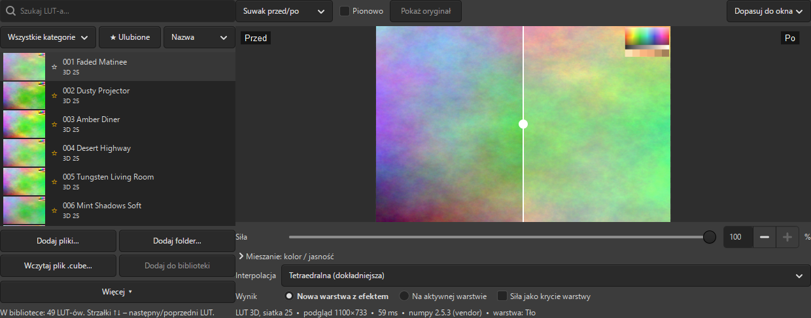
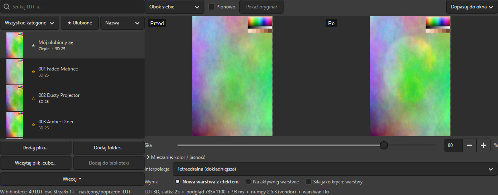

# LUT-y (.cube) – wtyczka GIMP 3

Darmowa wtyczka open source (GPL-3.0), która nakłada kolorystyczne tablice LUT w formacie `.cube` (te same, których używasz w Lightroomie, Photoshopie czy DaVinci Resolve). Ma własną bibliotekę LUT-ów, podgląd przed/po z suwakiem dzielącym i suwak siły efektu. Działa w pełni offline: bez kont, kluczy API i zbierania danych.



**Do paczki nie są dołączone żadne LUT-y.** Wtyczka to narzędzie: pliki `.cube` (własne albo kupione) importujesz do biblioteki z dysku.

Przetestowano na GIMP 3.2.6 (Windows 11).

## Instalacja (Windows)

Z rozpakowanej paczki `lut-cube-vX.Y.Z.zip` (albo z folderu repozytorium):

```powershell
powershell -ExecutionPolicy Bypass -File .\install.ps1 -Plugin lut-cube
```

Skrypt znajduje najnowszy katalog `%APPDATA%\GIMP\3.x` i kopiuje folder `lut-cube` do `plug-ins`. Uruchom potem GIMP ponownie. Menu: **Filtry → LUT**.

Ręcznie: skopiuj folder `lut-cube` tak, żeby powstała ścieżka `%APPDATA%\GIMP\3.2\plug-ins\lut-cube\lut-cube.py` (folder musi mieć tę samą nazwę co plik). Faktyczną ścieżkę sprawdzisz w GIMP-ie: *Edycja → Preferencje → Foldery → Wtyczki*.

### Szybki wariant (numpy)

Paczka wydania zawiera folder `lut-cube\vendor` z biblioteką numpy. Dzięki niej zdjęcie 24 Mpx przelicza się w ok. 4 s zamiast ok. 70 s. Jeśli instalujesz z repozytorium (tam folderu `vendor` nie ma), dograj go jednym poleceniem:

```powershell
powershell -ExecutionPolicy Bypass -File .\tools\fetch-numpy.ps1
```

Dlaczego nie zwykłe `pip install numpy`? GIMP na Windows ma własnego Pythona 3.14, zbudowanego w środowisku MSYS2 CLANG64. Koła numpy z PyPI są dla Pythona z python.org i się w nim nie załadują. Skrypt pobiera więc gotowe paczki MSYS2 (numpy 2.5.3 i OpenBLAS 0.3.34), sprawdza ich sumy SHA-256 i rozpakowuje je do `vendor` (ok. 60 MB, licencje BSD w `vendor\licenses`). Wtyczka ładuje ten numpy tylko wtedy, gdy pasuje do wersji Pythona w GIMP-ie. W przeciwnym razie przechodzi na wariant bez numpy.

Linux/macOS: `~/.config/GIMP/3.x/plug-ins/lut-cube/`, plik `lut-cube.py` musi mieć prawo wykonania. Jeśli Python w GIMP-ie ma numpy (zwykle ma go Python systemowy), wtyczka użyje go automatycznie.

## Użycie

1. Otwórz zdjęcie, w oknie *Warstwy* zaznacz warstwę.
2. **Filtry → LUT → Zastosuj LUT (.cube)…**
3. Wybierz LUT z listy. Podgląd odświeża się od razu, a **strzałki ↑/↓** przełączają kolejne LUT-y.
4. Ustaw siłę i kliknij **Zastosuj**.

Całość to **jeden krok cofania** (Ctrl+Z). Przy dużych zdjęciach widać pasek postępu z przyciskiem **Przerwij**. Przerwanie zostawia obraz bez zmian.

**Filtry → LUT → Zarządzaj biblioteką…** otwiera to samo okno bez obrazu: do importu i porządkowania LUT-ów, z podglądem na wbudowanym obrazku testowym (tęcza barw, szarości, odcienie skóry).

### Podgląd przed/po

| Tryb | Działanie |
|---|---|
| Suwak przed/po | lewa część to oryginał, prawa to efekt; linię przeciągasz myszą. Opcja *Pionowo*: góra/dół |
| Obok siebie | dwa obrazy obok siebie (albo jeden pod drugim) |
| Przełącznik przed/po | jeden obraz; kliknięcie w podgląd albo przycisk *Pokaż oryginał* przełącza |

W każdym trybie **przytrzymanie spacji** (albo `\`) pokazuje oryginał. Zoom: *Dopasuj do okna* albo *100 %* (wycinek w pełnej rozdzielczości, przesuwasz go przeciągnięciem).

Podgląd liczony jest na zmniejszonej kopii (dłuższy bok 1100 px; bez numpy 640 px) z krótkim opóźnieniem po zmianie suwaka. Uwzględnia zaznaczenie, siłę i mieszanie.



### Siła i mieszanie

- **Siła 0–100 %**: `wynik = oryginał · (1 − s) + LUT(oryginał) · s`, liczone na wartościach perceptualnych (jak w Lightroomie).
- **Mieszanie: kolor / jasność** (rozwijane): osobno ustalasz, ile zmiany barwy i ile zmiany jasności przenieść z LUT-a. *Jasność 0 %* daje sam look kolorystyczny bez zmiany kontrastu, a *Kolor 0 %* samą zmianę tonalną. Zmiana jasności to część różnicy wspólna dla R, G i B (luminancja Rec.709).
- **Interpolacja**: tetraedralna (domyślna, mniej artefaktów na szarościach i w gładkich przejściach) albo trójliniowa.

### Zapis wyniku

- **Nowa warstwa z efektem** (domyślnie, niedestrukcyjnie): kopia warstwy nad oryginałem, nazwa np. „LUT: 001 Faded Matinee 80%”, tryb Normalny, krycie 100 %. Siła jest zapisana w samych pikselach.
- **Siła jako krycie warstwy** (opcja): warstwa dostaje pełny efekt, a siła trafia do krycia, więc później możesz ją zmieniać w oknie *Warstwy*. GIMP miesza krycie w świetle liniowym, więc wynik nieznacznie różni się od siły „w pikselach”.
- **Na aktywnej warstwie**: nadpisuje piksele (z cofaniem).

Wybór, siła, mieszanie, interpolacja, tryb podglądu i ostatni LUT są zapamiętywane.

### Co jeszcze wtyczka obsługuje

- **Zaznaczenie**: efekt tylko w zaznaczeniu, z miękkimi krawędziami. Miękka krawędź jest mieszana tak jak w GIMP-ie (w świetle liniowym), więc podgląd zgadza się z wynikiem.
- **Kanał alfa**: nie jest zmieniany, przezroczyste piksele zostają przezroczyste.
- **Precyzja**: obrazy 8-, 16- i 32-bitowe (także liniowe) są liczone na float i zapisywane w precyzji obrazu, bez obcinania do 8 bitów.
- **Skala szarości / indeksowane**: wtyczka proponuje konwersję do RGB (z cofaniem). Wywołanie bez okna zwraca czytelny błąd.
- **Kilka zaznaczonych warstw**: LUT trafia na każdą z nich, a podgląd pokazuje pierwszą. Grupy, maski i kanały są pomijane z komunikatem.

## Biblioteka LUT-ów

Biblioteka to folder w katalogu konfiguracji GIMP-a: `%APPDATA%\GIMP\3.2\lut-cube\` (funkcja `Gimp.directory()`), w nim:

- `luts\`: **kopie** zaimportowanych plików, więc biblioteka nie zależy od miejsca, z którego je dodałeś,
- `index.json`: nazwa wyświetlana, plik, kategoria, ulubione, data dodania, rozmiar siatki, typ (1D/3D), SHA-256, ostatnio użyte, ustawienia,
- `cache\*.lutc`: sparsowane LUT-y w formacie binarnym (wczytanie trwa milisekundy, a nie ~0,1 s na parsowanie 400 KB tekstu).

Co możesz zrobić:

- **Dodaj pliki…** (wielokrotny wybór), **Dodaj folder…** (z podfolderami), **przeciągnij** pliki lub foldery na listę.
- **Deduplikacja po SHA-256**: plik o tej samej treści nie zostanie dodany drugi raz; podsumowanie importu mówi, ile pominięto. Uszkodzone pliki są pomijane z opisem błędu, reszta importu idzie dalej.
- **Zmiana nazwy** (plik na dysku się nie zmienia), **kategorie** (własne: dodaj / zmień nazwę / usuń w *Więcej → Kategorie…*), **ulubione** (kliknij ☆ przy nazwie), **usuwanie** (pytanie; opcjonalnie razem z plikiem w folderze biblioteki). Prawy przycisk na LUT-cie otwiera menu.
- **Wyszukiwarka** po nazwie, filtr kategorii i ulubionych, sortowanie po nazwie lub dacie dodania. **Ulubione i 5 ostatnio użytych są zawsze na górze.**
- **Miniatury** liczone leniwie na bieżącym obrazie, w tle, po jednej; lista od razu jest gotowa do użycia.
- **Wczytaj plik .cube…** nakłada dowolny plik bez dodawania go do biblioteki. Obok jest **Dodaj do biblioteki**. Okna wyboru pamiętają ostatni folder.

### Import startowy

Przy pierwszym uruchomieniu z pustą biblioteką wtyczka proponuje import z folderu z LUT-ami. Folder jest wybierany w tej kolejności:

1. ustawienie *Więcej → Ustawienia… → Folder importu startowego*,
2. plik `startup-dir.txt` obok wtyczki. Zapisuje go `install.ps1`, jeśli obok skryptu leży folder `Luts` (wielkość liter bez znaczenia); same pliki `.cube` **nie** są kopiowane do folderu wtyczki,
3. folder `LUTS` / `Luts` w katalogu domowym, w *Obrazy* albo w *Dokumenty*.

Zawsze możesz wskazać inny folder (*Wybierz folder…*) albo ponowić import: *Więcej → Import startowy…*.

### Skracanie nazw

Domyślnie wspólny prefiks `Zetmar - Cyfrowy Przyjaciel - ` jest pomijany w nazwie wyświetlanej: plik `Zetmar - Cyfrowy Przyjaciel - 001 Faded Matinee.cube` widać jako **001 Faded Matinee**. Prefiks i włączenie skracania zmienisz w *Więcej → Ustawienia…*. Pliki na dysku zostają bez zmian.

## Przestrzeń kolorów

LUT-y `.cube` zakładają wartości w kodowaniu perceptualnym (gamma sRGB), tak jak w Lightroomie i Photoshopie. GIMP 3 często pracuje wewnętrznie w świetle liniowym, dlatego wtyczka czyta i zapisuje piksele w formacie babl **`R'G'B'A float`** (apostrofy = wartości nieliniowe). LUT działa więc na tych samych liczbach co w innych programach, niezależnie od tego, czy obraz ma precyzję liniową czy perceptualną.

Zgodność sprawdza test porównujący wynik z filtrem **ffmpeg `lut3d`** na prawdziwych LUT-ach (tetraedralna i trójliniowa): maksymalna różnica wynosi ok. 2/65535.

**Obrazy w innych profilach niż sRGB** (np. Adobe RGB): GIMP podaje wtyczce wartości w przestrzeni obrazu, bez przeliczania barw. LUT-y robione dla sRGB dałyby wtedy inny wynik niż w Lightroomie. Okno pokazuje ostrzeżenie z przyciskiem **Konwertuj do sRGB** (konwersja perceptualna z kompensacją punktu czerni, z cofaniem). Bez konwersji LUT zostanie nałożony na wartości obrazu tak, jakby były sRGB.

## Wydajność

Zmierzone na Windows 11, GIMP 3.2.6, procesor 12-wątkowy, LUT 25³, interpolacja tetraedralna:

| | z numpy (vendor) | bez numpy (czysty Python) |
|---|---|---|
| Zdjęcie 6000×4000 (24 Mpx), całe wywołanie z odczytem i zapisem | **ok. 4,5 s** | ok. 70 s (6 Mpx: 17,7 s) |
| Same obliczenia 24 Mpx | 2,0 s | ok. 100 s |
| Przeliczenie podglądu | ok. 80–100 ms (1100×733) | ok. 1,4 s (640×427) |
| Miniatury 49 LUT-ów (same obliczenia) | poniżej 0,5 s | ok. 0,4 s |

Pierwsze otwarcie okna z importem startowym 49 plików (kopiowanie, parsowanie, cache i miniatury) trwało ok. 5 s.

Wariant numpy liczy kawałkami po 128 tys. pikseli równolegle w kilku wątkach. Wariant bez numpy liczy każdy unikalny kolor tylko raz (cache), więc zdjęcia z 8-bitowego JPEG-a idą w nim szybciej niż szum. Wariant bez numpy można wymusić zmienną środowiskową `LUT_CUBE_NO_NUMPY=1`.

## Format .cube

Obsługiwane: komentarze `#`, `TITLE`, końce linii CRLF/LF, BOM, `LUT_3D_SIZE` (2–256), `LUT_1D_SIZE`, plik z częścią 1D i 3D naraz (najpierw 1D, potem 3D), `DOMAIN_MIN`/`DOMAIN_MAX` oraz `LUT_1D_INPUT_RANGE`/`LUT_3D_INPUT_RANGE`. Kolejność danych: R zmienia się najszybciej. Wartości wyjściowe spoza 0–1 są przycinane. Błędy (przecinek zamiast kropki, zła liczba wierszy, brak rozmiaru, tekst zamiast liczb) dają komunikat po polsku z numerem wiersza.

## Wywołanie bez okna (Python-Fu / skrypty)

```python
from gi.repository import Gimp, Gio
proc = Gimp.get_pdb().lookup_procedure("python-fu-lut-cube-apply")
cfg = proc.create_config()
cfg.set_property("run-mode", Gimp.RunMode.NONINTERACTIVE)
cfg.set_property("image", image)
cfg.set_core_object_array("drawables", image.get_selected_drawables())
cfg.set_property("lut-file", Gio.File.new_for_path(r"C:\LUT\film.cube"))
cfg.set_property("strength", 80.0)            # 0–100
cfg.set_property("output", "new-layer")       # albo "in-place"
cfg.set_property("interpolation", "tetrahedral")  # albo "trilinear"
cfg.set_property("color", 100.0)              # 0–100
cfg.set_property("luminance", 100.0)          # 0–100
cfg.set_property("strength-as-opacity", False)
proc.run(cfg)
```

Po użyciu okna *Filtry → Powtórz* nakłada ten sam LUT z tymi samymi ustawieniami bez okna.

## Testy

- Bez GIMP-a (parser, interpolacja, biblioteka; porównanie z ffmpeg i scipy, jeśli są w systemie):
  ```
  python -m pytest tests/test_lut_cube.py
  ```
- W GIMP-ie, bez okna (procedura, zaznaczenie, alfa, 16/32 bit, błędy, czas 24 Mpx). Wymaga zainstalowanej wtyczki. Uruchom z folderu repozytorium:
  ```
  "%LOCALAPPDATA%\Programs\GIMP 3\bin\gimp-console-3.2.exe" -i --batch-interpreter python-fu-eval -b "exec(open(r'tests/gimp_lut_integration.py', encoding='utf-8').read())" --quit
  ```
- Okno (budowane poza ekranem, akcje jak z przycisków i klawiszy, zrzuty do `docs/lut-cube/`): to samo polecenie z `tests/gimp_lut_ui.py`.

Obrazy testowe testy generują same. Jeśli w repo jest folder `Luts/` z plikami `.cube`, testy go używają; jeśli nie (jak w publicznym repo), generują kilka syntetycznych LUT-ów.

## Znane ograniczenia

- **Profile inne niż sRGB** wymagają konwersji (przycisk w oknie). Bez niej wynik różni się od programów, które konwertują automatycznie.
- **Wartości HDR (> 1) w obrazach 32-bitowych**: wejście LUT-a jest przycinane do domeny (zwykle 0–1), tak jak w innych programach. Zmiana dodana przez LUT nie usuwa jednak jasności ponad 1.
- **Podgląd 100 %** liczy wycinek wielkości okna podglądu. Przy przeciąganiu widać przesunięty stary wycinek, a nowy liczy się po puszczeniu myszy.
- **Numpy w paczce** pasuje do Pythona 3.14 z GIMP-a 3.2 (Windows). Po aktualizacji GIMP-a ze zmianą wersji Pythona wtyczka sama przejdzie na wariant bez numpy. Wtedy uruchom ponownie zaktualizowany `tools\fetch-numpy.ps1`.
- **Tryb wsadowy** (wiele plików naraz) nie jest wbudowany. Da się go zrobić skryptem Python-Fu z wywołaniem bez okna (przykład wyżej).

## Licencja

Wtyczka: GPL-3.0 (plik `LICENSE`). Dołączany numpy i OpenBLAS: BSD-3-Clause (licencje w `vendor\licenses`).
