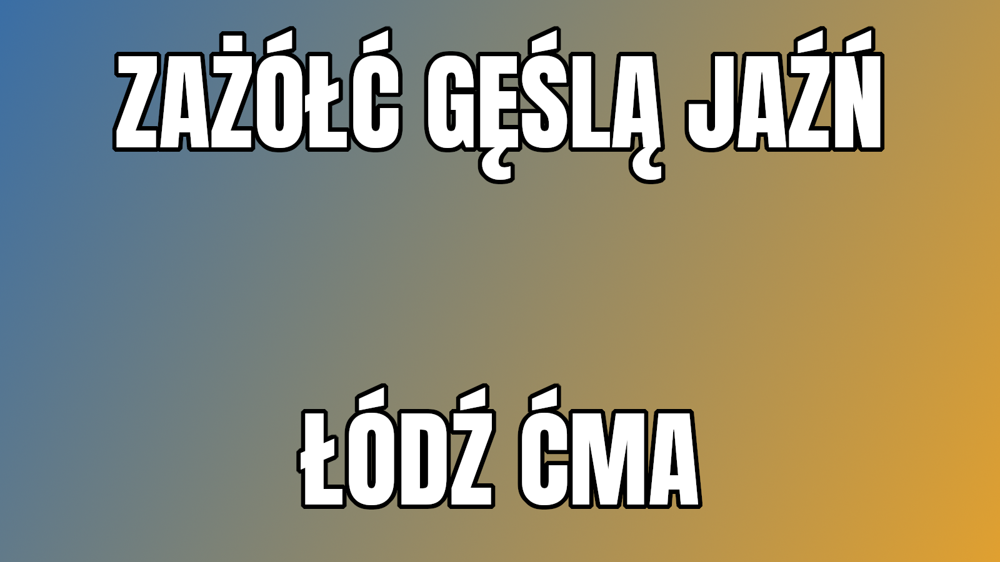
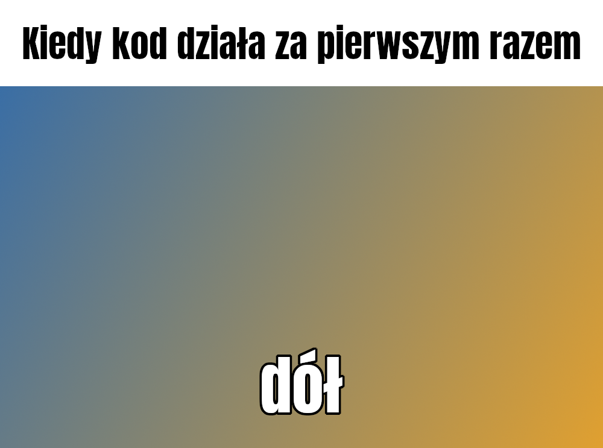

# Kreator memów – wtyczka GIMP 3

Darmowa wtyczka open source (GPL-3.0), która ze zwykłego zdjęcia robi mema: tekst górny i dolny z czarnym obrysem albo klasyczny „biały pasek u góry”. Działa w pełni offline: bez kont, kluczy API, płatnych usług i zbierania danych. Nie potrzebuje niczego poza samym GIMP-em 3.





Przetestowano na GIMP 3.2.6 (Windows 11).

## Instalacja (Windows)

Z folderu repozytorium (albo rozpakowanej paczki):

```powershell
powershell -ExecutionPolicy Bypass -File .\install.ps1 -Plugin meme-maker
```

Skrypt sam znajduje najnowszy katalog `%APPDATA%\GIMP\3.x` (wersję można wymusić: `-Version 3.0`), kopiuje folder `meme-maker` do `plug-ins` i czcionkę Anton do folderu `fonts` GIMP-a. Potem uruchom GIMP ponownie.

Ręcznie: skopiuj folder `meme-maker` tak, żeby powstała ścieżka

```
%APPDATA%\GIMP\3.2\plug-ins\meme-maker\meme-maker.py
```

Folder musi mieć tę samą nazwę co plik `.py`. Faktyczną ścieżkę sprawdzisz w GIMP-ie: *Edycja → Preferencje → Foldery → Wtyczki*. Czcionki nie trzeba kopiować ręcznie: jeśli w systemie nie ma Antona, wtyczka przy pierwszym użyciu sama skopiuje dołączony plik do folderu czcionek GIMP-a.

Linux/macOS: `~/.config/GIMP/3.x/plug-ins/meme-maker/`, plik musi mieć prawo wykonania (`chmod +x meme-maker.py`).

## Użycie

1. Otwórz zdjęcie.
2. **Filtry → Memy → Stwórz mema…**
3. Wpisz tekst górny i/lub dolny (Enter = nowa linia) i kliknij OK.
4. Opcjonalnie **Filtry → Memy → Eksportuj mema…**, żeby zapisać JPG/PNG.

Całość to **jeden krok cofania**: jedno Ctrl+Z usuwa mema. Oryginalna warstwa ze zdjęciem zostaje nietknięta. Tekst trafia do grupy warstw „Mem”: każdy blok to warstwa tekstowa i pod nią osobna warstwa obrysu.

### Opcje okna „Stwórz mema”

| Pole | Opis | Domyślnie |
|---|---|---|
| Tekst górny / dolny | Wielolinijkowe; puste pole = brak tekstu | – |
| Czcionka | *Automatycznie* albo *Wybrana poniżej* | Automatycznie |
| Własna czcionka | Używana w trybie „Wybrana poniżej” | – |
| Rozmiar czcionki (px) | 0 = auto, proporcjonalnie do szerokości (≈ 1/9 szerokości) | 0 |
| Kolor tekstu | | biały |
| Kolor obrysu | | czarny |
| Grubość obrysu | % rozmiaru czcionki; 0 = bez obrysu | 4 % |
| WIELKIE LITERY | Działa też z polskimi znakami (ą → Ą) | włączone |
| Wyrównanie | do środka / lewej / prawej | do środka |
| Margines | % krótszego boku zdjęcia | 4 % |
| Pasek na tekst | Brak / nad zdjęciem (tekst górny) / pod zdjęciem (tekst dolny) | Brak |
| Kolor paska | Biały (czarny tekst) albo czarny (biały tekst) | Biały |
| Edytowalne warstwy tekstowe | Wyłączone: mem spłaszczony do jednej warstwy „Mem” nad zdjęciem | włączone |

**Kolejność automatycznego wyboru czcionki:** Anton → Impact (jeśli zainstalowany) → Arial Black → Sans-serif Bold.

**Auto-dopasowanie.** Jeśli tekst nie mieści się w szerokości zdjęcia (minus marginesy), wtyczka zawija go na kilka linii. Jeśli nadal się nie mieści (bardzo długie słowo albo blok wyższy niż 30 % zdjęcia), zmniejsza czcionkę krokami po 10 %, do minimum 8 px.

**Pasek.** Płótno zostaje powiększone o pasek, zdjęcie przesuwa się (bez zmiany pikseli), a tekst z danej strony trafia do paska: w kontrastowym kolorze i bez obrysu. Tekst z drugiej strony zostaje na zdjęciu w zwykłym stylu memowym.

### Eksport

*Filtry → Memy → Eksportuj mema…* zapisuje widoczny obraz do **JPG** (jakość 1–100, domyślnie 90) albo **PNG** (kompresja 0–9). Domyślna nazwa to `<nazwa-zdjęcia>-mem.jpg` obok oryginału. Eksport działa na kopii, więc obraz w GIMP-ie zostaje bez zmian. Jeśli rozszerzenie nie pasuje do formatu, wtyczka je poprawia.

## Wywołanie ze skryptu (Python, PDB)

```python
proc = Gimp.get_pdb().lookup_procedure("python-fu-meme-maker")
cfg = proc.create_config()
cfg.set_property("run-mode", Gimp.RunMode.NONINTERACTIVE)
cfg.set_property("image", image)
cfg.set_core_object_array("drawables", image.get_selected_drawables())
cfg.set_property("top-text", "Kiedy kod działa")
cfg.set_property("bottom-text", "za pierwszym razem")
proc.run(cfg)
```

Identyfikatory argumentów: `top-text`, `bottom-text`, `font-mode` (`auto`/`custom`), `font`, `font-size`, `text-color`, `outline-color`, `outline-percent`, `uppercase`, `align` (`center`/`left`/`right`), `margin-percent`, `bar` (`none`/`top`/`bottom`), `bar-color` (`white`/`black`), `editable`. Eksport: `python-fu-meme-export` z `file`, `format` (`jpg`/`png`), `quality`, `png-compression`.

## Testy

- Czyste funkcje (wybór czcionki, zawijanie, dopasowanie, marginesy), bez GIMP-a:
  ```
  python -m pytest tests
  ```
- Test integracyjny w prawdziwym GIMP-ie (headless, wtyczka musi być zainstalowana). Podglądy PNG trafiają do `%TEMP%\meme_test`:
  ```
  "%LOCALAPPDATA%\Programs\GIMP 3\bin\gimp-console-3.2.exe" -i --batch-interpreter python-fu-eval -b "exec(open(r'C:\ścieżka\do\repo\tests\gimp_meme_integration.py', encoding='utf-8').read())" --quit
  ```
  Ostatni wynik: 86/86 PASS.

## Znane ograniczenia

- **Obrys nie śledzi edycji tekstu.** Gdy zmienisz treść warstwy tekstowej narzędziem Tekst, warstwa obrysu zostaje stara. Usuń mema (Ctrl+Z) i uruchom wtyczkę ponownie albo popraw obrys ręcznie.
- **Bardzo mały obraz + bardzo długi tekst.** Poniżej 8 px czcionka nie jest już zmniejszana. Na obrazku rzędu 120×80 px długi tekst się nie zmieści, a bloki mogą na siebie nachodzić. GIMP pokazuje wtedy ostrzeżenie.
- **Odstęp wokół liter.** Warstwa tekstowa ma wewnętrzny odstęp z metryk czcionki, więc wizualny margines bywa nieco większy niż ustawiony.
- **Domyślne kolory a GIMP 3.2.** GIMP nie przekazuje domyślnej wartości argumentów-kolorów (przychodzi kolor w pełni przezroczysty). Wtyczka traktuje kolor przezroczysty jako „nieustawiony” i wstawia biały/czarny. Skutek uboczny: nie da się wybrać w pełni przezroczystego koloru tekstu, co i tak nie ma sensu.
- **Arial Black** bywa niewidoczny dla GIMP-a, nawet gdy jest w Windows (tak było na komputerze testowym). Wtedy wybór przechodzi od razu do Sans-serif Bold.
- Nieaktywne pola (np. *Własna czcionka* przy trybie automatycznym, *Kolor paska* bez paska) są wyszarzone, ale nie ukryte.

## Licencje

- Kod wtyczki: **GPL-3.0**, pełny tekst w [`LICENSE`](LICENSE).
- Czcionka **Anton** (`fonts/Anton-Regular.ttf`), © 2020 The Anton Project Authors, na licencji **SIL Open Font License 1.1** ([`fonts/OFL.txt`](fonts/OFL.txt)). Można ją swobodnie rozpowszechniać razem z wtyczką. Licencja OFL musi zostać dołączona, a czcionki nie wolno sprzedawać osobno.
- **Impact** to czcionka komercyjna. Wtyczka jej **nie dołącza**, tylko używa, jeśli jest już zainstalowana w systemie.
